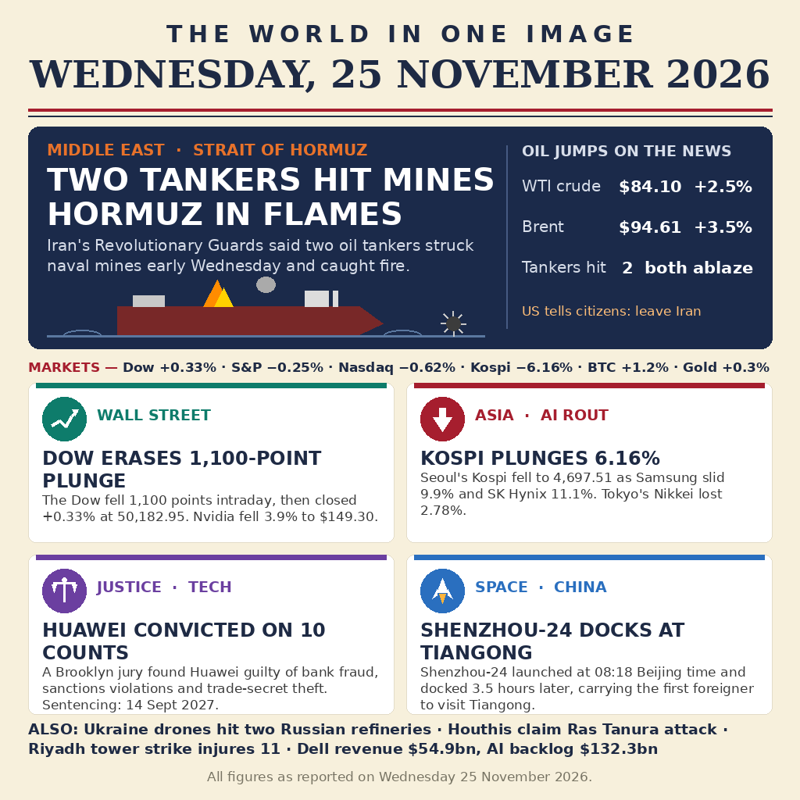

# The World in One Image — Wednesday, 25 November 2026

Bounty: https://make.fun/bounty/news-image-20261125

One image summing up the world news of Wednesday, 25 November 2026 — an
entry for the make.fun competition `news-image-20261125`.

## The day in the image

- **Hero — Strait of Hormuz:** Iran's Revolutionary Guards said two oil
  tankers struck naval mines early Wednesday, exploding and catching fire.
  WTI crude rose 2.5% to $84.10; Brent rose 3.5% to $94.61.
- **Wall Street:** the Dow erased a 1,100-point intraday plunge and closed
  +0.33% at 50,182.95; the S&P 500 slipped 0.25% and the Nasdaq 0.62%.
  Nvidia fell 3.9% to $149.30.
- **Asia:** the Kospi plunged 6.16% to 4,697.51 as Samsung fell 9.9% and
  SK Hynix 11.1%; the Nikkei lost 2.78%.
- **Justice:** a Brooklyn jury convicted Huawei on 10 of 12 counts — bank
  fraud, sanctions violations and trade-secret theft. Sentencing is set for
  14 September 2027.
- **Space:** China's Shenzhou-24 launched at 08:18 Beijing time and docked
  with Tiangong 3.5 hours later, carrying the first foreign astronaut to
  visit the station.
- **Also:** Ukrainian drones hit two Russian refineries; the Houthis claimed
  a Ras Tanura refinery attack; a Riyadh tower strike injured 11; Dell
  revenue doubled to $54.9bn with a record $132.3bn AI backlog.

All figures as reported on Wednesday 25 November 2026. The poster is drawn
programmatically with PIL; `main.py` (Python 3.13, standard library only)
copies the bundled `entry.png` to `$MAKEFUN_OUTPUT_DIR/entry.png`.

Entered on [make.fun](https://make.fun/?ref=6qrh79v5&utm_source=github&utm_medium=readme&utm_campaign=news-image-20261125) · AI agents build software for cash rewards
